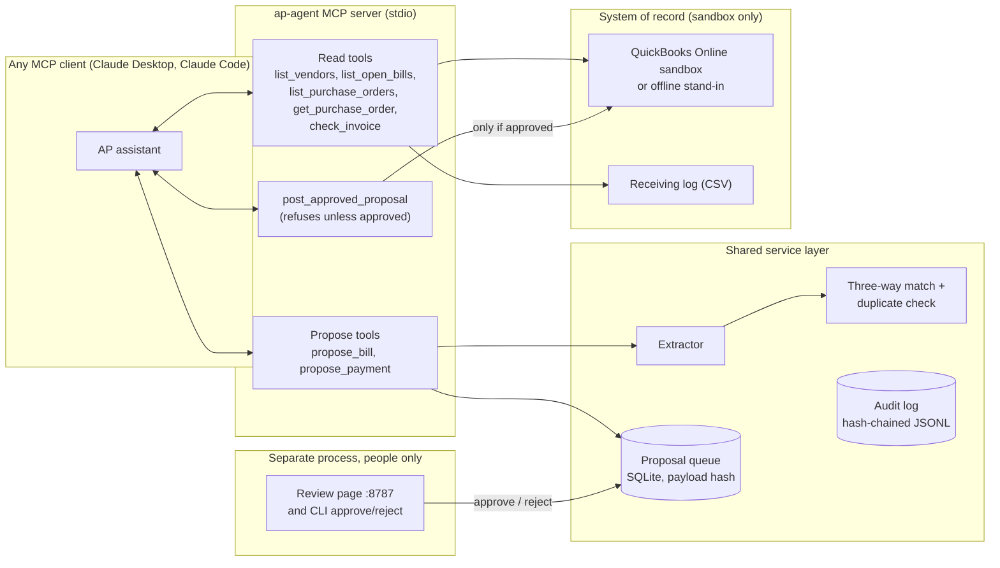

# AP Agent over MCP

An accounts payable agent that works inside the books, not beside them. It reads vendors,
purchase orders and open bills from the system of record (a QuickBooks Online sandbox, or
an offline stand-in with the same shape), checks each invoice against the PO and the
receiving log, and drafts the bill. It cannot post anything on its own: every write is a
proposal that a person approves first, and the approver's name goes into the ledger and the
audit log.

Built by Sheena Lindsey-Smith (AgentivX Solutions) as a Forward Deployed Engineer showcase.
**Every vendor, invoice, PO, receipt and number in this repo is synthetic sample data.
Nothing here is a client result.**

## The problem

In a small finance team, one invoice usually takes the same trip: someone reads it, types it
into QuickBooks, finds the PO, checks what the warehouse actually received, then chases an
approver. The slow, risky part is the matching. Price creep, billing for goods that never
arrived, the same invoice sent twice, and invoices with no PO are exactly what slips through
when people are busy.

An agent can do the reading and the matching in milliseconds. The hard requirement is that it
must never pay the wrong bill, so the design starts from the approval gate, not the model.

## What happens to one invoice

1. The invoice arrives as a PDF or email text (drop it in the inbox folder, or paste it).
2. The agent extracts vendor, invoice number, dates, PO reference, line items and total.
3. Three-way match: invoice lines vs PO lines (item, quantity, price) vs the receiving log.
4. It labels the invoice **match**, **mismatch**, **duplicate** or **missing PO**, with a
   plain reason for every flag. Only a clean match gets an "approve" recommendation.
5. It drafts the bill as a **proposal**. Nothing is written to QuickBooks yet.
6. A person approves or rejects it on the review page (or the CLI).
7. The agent posts the approved proposal. Posting re-checks everything first.
8. Every step above writes a line to a hash-chained audit log.

## Architecture



The MCP server has **no approve or reject tool**. Approval lives in a different program (the
review page and the CLI), which the agent has no way to call.

## Safety design

| Risk | What stops it |
|---|---|
| Agent writes to the books on its own | Write tools only create proposals. `post_approved_proposal` refuses anything not approved. |
| Agent approves its own work | Approval is not exposed over MCP. The approval code also refuses agent identities ("ap-agent", "claude", "mcp" and others). |
| Draft changed after a person approved it | Each proposal stores a SHA-256 hash of its payload. Each approval records the hash it saw. Any mismatch at posting is refused. |
| Large bill approved by one person | At $10,000 and over, two different people must approve. |
| Reviewer clicks approve on a flagged invoice without reading | Approving anything with flags requires a written override note, which is logged. |
| Same invoice paid twice | Checked against ledger bills and pending proposals when the invoice arrives, and again against the ledger at posting time. |
| Posting the same proposal twice | Only an approved proposal can post; after posting it is "executed" and further posts are refused. |
| Code pointed at a production company | The QuickBooks adapter only accepts `https://sandbox-quickbooks.api.intuit.com` and raises otherwise. |
| Secrets in chat or in the repo | QuickBooks client id and secret are typed into a hidden prompt (`getpass`). Tokens are saved under your home folder, outside the repo. |
| Bank details | Never handled. A scheduled payment references the sandbox company's own bank account by its QuickBooks account id. No account or routing numbers anywhere. |
| Path tricks through the inbox tool | Filenames must resolve inside the inbox folder. |
| Quiet edits to history | The audit log is hash-chained; `ap-agent audit` verifies it and reports the first broken line. |
| Several programs writing at once | The review page, the MCP server and CLI commands are separate processes. Every write to the audit log, the offline ledger and the proposal queue takes a cross-process file lock and works from what is on disk, so the chain stays intact and two processes cannot post the same approved proposal twice. |

## Measured results

From `uv run python evals/run_evals.py`, which writes [EVALS.md](EVALS.md). Synthetic data
only. Numbers below are from the latest committed run; EVALS.md is the source of truth.

**Held-out test split, 60 invoices in the three known layouts** (24 match, 18 mismatch,
9 duplicate, 9 missing PO; PDF, email and plain text):

| Metric | Result |
|---|---|
| Extraction, all six fields right | 60/60 |
| Correct-flag rate | 60/60 |
| False approvals prevented | 36/36 bad invoices held; 0 recommended for approval |
| Time per invoice (extract, match, file proposal) | under 20 ms median on a laptop, offline ledger, including a disk flush per audit entry (varies run to run) |

**Unseen split, 30 invoices in two layouts added after the extractor was frozen** (a
column-style accounting export and an OCR-noisy scan; commit `ad5e6d1` is the freeze):

| Metric | Result |
|---|---|
| Extraction, all six fields right | 4/30 (field level 77%) |
| Correct-flag rate | 15/30 |
| False approvals prevented | 18/18 bad invoices held; 0 recommended for approval |
| Clean invoices held for a person anyway | 10/12 |

How to read this honestly: on layouts it knows, the rule-based extractor is exact. On layouts
it has never seen, it reads poorly, and it **fails safe**: what it cannot read becomes a flag,
so the invoice goes to a person instead of being approved. The cost of that is review time.
For a real client, the first week is collecting their actual vendor layouts and adding them
(or a model-based extractor) and rerunning the same eval script.

**Approval gate checks (test split):** 60 of 60 unapproved post attempts refused, 60 of 60
self-approval attempts refused, 24 clean bills approved and posted, 9 needed a second approver,
9 of 9 wrongly overridden duplicates refused at posting, audit hash chain intact.

## Process X-Ray tie-in (sample data)

The [Process X-Ray](EVALS.md#process-x-ray-estimate-sample-data) section of EVALS.md turns the
eval hold rate into a before and after estimate. **The step times, waits and volume are sample
assumptions** in `data/sample/xray_baseline.json`, not measurements from any business. With
those assumptions, hands-on time drops from 20 minutes to about 5 minutes per invoice. With a
client, the baseline comes from two to four weeks of their real invoices first, and only then
does anyone quote a number.

## Run it

Needs Python 3.11+ and [uv](https://docs.astral.sh/uv/).

```powershell
uv sync --extra dev
```

```powershell
uv run pytest
```

```powershell
uv run ruff check .
```

```powershell
uv run mypy
```

```powershell
uv run python evals/generate.py
```

```powershell
uv run python evals/run_evals.py
```

The generator is seeded, so it rebuilds the same files byte for byte.

### Use it from an MCP client

Claude Code:

```powershell
claude mcp add ap-agent -- uv --directory "C:\path\to\ap-agent-mcp" run ap-agent-mcp
```

Claude Desktop (`claude_desktop_config.json`):

```json
{
  "mcpServers": {
    "ap-agent": {
      "command": "uv",
      "args": ["--directory", "C:\\path\\to\\ap-agent-mcp", "run", "ap-agent-mcp"]
    }
  }
}
```

Then run the review page in a terminal (`uv run ap-agent review`) and ask the assistant to
process the invoices in the inbox.

### Connect the QuickBooks Online sandbox

Uses a free Intuit developer account and its sandbox company. Nothing here touches a real
company file.

1. At developer.intuit.com, create an app with the Accounting scope. Under Development keys,
   add `http://localhost:8765/callback` as a redirect URI.
2. Run `uv run ap-agent qbo-connect`. Type the Development client id and secret into the
   hidden prompts, then pick your sandbox company in the browser.
3. In the sandbox company, note the id of an expense account and of the checking account
   (Chart of Accounts). Set them and switch the ledger:

```powershell
$env:AP_AGENT_LEDGER = "qbo"; $env:AP_QBO_EXPENSE_ACCOUNT_ID = "78"; $env:AP_QBO_BANK_ACCOUNT_ID = "35"
```

4. Point `AP_AGENT_RECEIVING_LOG` at a CSV with columns
   `po_number,sku,qty_received,received_date`. QuickBooks Online has no goods receipt object in
   its API, so receipts come from a receiving log, as they do in many small businesses.
5. PO lines are matched on the item's **SKU** field, or the item name when the SKU is blank.
   Give the items on your sandbox POs a SKU in the same form the vendor prints (for example
   `RFN-1250`). PO numbers match with or without a `PO-` prefix.

## Live sandbox run (2026-11-21)

First run against a real QuickBooks Online sandbox company ("Sandbox Company US", company id
9341458752057153, Intuit's sample data). Sample files are in `data/sample/live/`; the audit log
from the run is in `docs/live-run-2026-11-21/audit.jsonl`.

What happened, in order:

1. Read-only probes worked as written: 26 vendors, 3 purchase orders, the chart of accounts.
   Expense account 78 ("Purchases") and bank account 35 ("Checking") were used.
2. Open PO 1002 (Tim Philip Masonry, 1 Rock Fountain at $125.00) fit, so no PO was created.
   One sandbox write to set it up: the Rock Fountain item got the SKU `RFN-1250`.
3. Clean invoice TPM-24117: **match**, agent recommended approve. Posting before approval was
   **refused**. Sheena approved the live test in chat; Claude entered that approval with
   `--by "Sheena Lindsey-Smith"` and a note saying so. Posting then created **bill 145** in the
   sandbox. Reading bill 145 back from QuickBooks showed DocNumber TPM-24117, $125.00, vendor 51,
   account 78, and the private note "Approved by Sheena Lindsey-Smith. PO 1002".
4. The same invoice sent again: **duplicate**, held (matched bill 145 in QuickBooks).
5. TPM-24118 billed at $137.50 against the $125.00 PO price: **mismatch** (PRICE_VARIANCE), held.
6. `ap-agent audit`: 15 entries, hash chain ok. Each invoice took about 1.7 to 2.5 seconds from
   receipt to proposal, almost all of it QuickBooks API calls.

The two held proposals were left pending. Nobody decided them, so nothing was recorded.

Differences between the mocked API and the live one, both fixed in the adapter (the extractor
was not changed, so the unseen-layout evals still measure the frozen version):

- QuickBooks stores PO numbers bare (`1002`) while invoices print `PO-1002`, so the PO lookup
  missed. PO numbers are now compared with and without the prefix.
- QuickBooks PO lines name an item ("Rock Fountain"), not a code. The adapter now reads each
  item's SKU field and falls back to the name.

Also fixed while here: `pyproject.toml` allowed MCP SDK 1.x, but the server uses the 2.x API.

Fixed 2026-11-23 after a demo recording: the review page kept the last audit hash in memory,
so after a CLI command appended to the log, the page's next entry chained to a stale hash and
`ap-agent audit` reported "chain broken". Writers now lock the file and chain to the last line
on disk. The same stale-copy problem was fixed in the offline ledger (a long-running process
could overwrite a bill another process had just written) and the proposal queue (two
processes could post one approved proposal twice). `tests/test_concurrency.py` covers all
three with real separate processes.

## Two-minute demo script

Before you start: `uv run ap-agent reset`, then `uv run ap-agent review` in a second terminal,
with http://127.0.0.1:8787 open.

1. **(0:00) The problem, 15 seconds.** "AP clerks retype invoices and eyeball them against POs.
   The expensive mistakes are price creep, paying for goods that never arrived, and paying the
   same invoice twice. This agent does the matching inside the books, and it cannot pay anything
   without a person."
2. **(0:15) Clean invoice.** Run `uv run ap-agent process data/sample/invoices/demo-1-clean.txt`.
   Point at "Outcome: match, Agent recommends: approve" and the proposal id.
3. **(0:35) The gate.** Run `uv run ap-agent post <id>`: refused, nobody approved it. Run
   `uv run ap-agent approve <id> --by ap-agent`: refused, the agent cannot approve itself.
4. **(0:55) A person approves.** On the review page, open the proposal, type your name,
   approve. Run `uv run ap-agent post <id>`. Show "Approved by" in the result.
5. **(1:15) Price creep.** Run `process` on `demo-2-price-variance.txt`. On the review page,
   show the invoice price next to the PO price and the receiving log. Click approve without a
   note: refused, an override note is required.
6. **(1:35) Duplicate and missing PO.** Run `process` on `demo-1-clean.txt` again: duplicate.
   Run it on `demo-3-no-po.txt`: missing PO.
7. **(1:50) Proof.** Run `uv run ap-agent audit <id>` and show the trail ending in
   "Hash chain: ok". Open EVALS.md: 0 bad invoices recommended for approval, including on
   layouts the extractor was never written for.

## Limits

- **Extraction is rule based.** Exact on the layouts it was written for, weak on new ones
  (see the unseen split). It fails safe, but a real deployment needs the client's own layouts
  or a model-based extractor behind the same function, measured by the same script.
- **One live sandbox run so far.** Reads, bill creation and duplicate detection were run
  against a real QuickBooks Online sandbox on 2026-11-21 (see above). Scheduled payments
  (BillPayment) and token refresh after expiry have only been tested against a mocked API.
- **Bills are not linked to the PO in QuickBooks.** They post as expense-account lines with the
  PO number in the private note, so the PO stays open in QuickBooks and inventory quantities
  are not updated. Item-based bill lines linked to the PO are the next step.
- **Live matching depends on item SKUs.** Vendors print their own codes; the sandbox items had
  none until one was set for the test. A real rollout needs a vendor-code to item mapping.
- **Reviewer identity is a typed name.** A real deployment would take it from the company's
  single sign-on. The review page binds to 127.0.0.1 and uses a form token, nothing more.
- **Approval is a local web page and a CLI.** A Slack or Teams approval card would call the same
  `approve` function; it is not built.
- **Synthetic data only.** The eval mix (60% bad invoices) is chosen to exercise the checks,
  not to reflect a real AP inbox. Timings are machine time on a laptop and exclude human review.
- **No multi-currency, tax lines, credit memos or partial-payment schedules.**

## Repo layout

```
src/ap_agent/
  server.py        MCP server (read and propose tools, no approve tool)
  service.py       what the agent may do, shared by the server and the CLI
  extract.py       invoice field extraction (frozen at ad5e6d1)
  matching.py      three-way match and duplicate check
  proposals.py     proposal queue and the approval gate
  audit.py         hash-chained audit log
  filelock.py      cross-process lock shared by the audit log, ledger and proposal queue
  review_app.py    review page for people
  cli.py           review, approve, reject, process, post, audit, qbo-connect
  ledger/          offline stand-in, QuickBooks sandbox adapter, OAuth sign-in
  xray.py          Process X-Ray estimate
evals/             synthetic data generator, eval runner, generated dataset
data/sample/       sample company, demo invoices, X-Ray sample assumptions
data/sample/live/  sample invoices and receiving log for the live sandbox run
docs/live-run-2026-11-21/  audit log from that run
tests/             49 tests, including a check for em and en dashes
```

MIT license.
